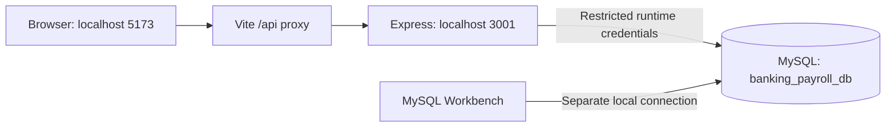

# Connect and visualize Ledgerline

## Open the application

On this configured machine, MySQL and the application credentials are already connected. In a terminal:

```powershell
cd D:\DBMS
npm run dev
```

Keep that terminal open. Visit [Sign in](http://127.0.0.1:5173/login). Read your generated application password locally in the ignored `.env.admin.json` file. This is separate from the MySQL root password. Ctrl+C stops the frontend and API.

After signing in:

| Page | What to inspect |
| --- | --- |
| `/app` | Current balances, date-filtered banking and payroll charts, recent activity |
| `/app/reports` | Banking, payroll, account reconciliation and branch reports; CSV downloads |
| `/app/users` | Create a real reviewer, assign fixed roles, disable access or reset passwords |
| `/app/audit-logs` | Search dated activity and expand before/after changes |
| `/app/settings` | Read-only system information and balance reconciliation |

Available pages and data depend on your permissions. Dashboard charts include exact-value tables. Current account balances are snapshots; date filters select activity, not historical balances. Payroll dates refer to the payroll period.

The preserved database has ten frozen accounts and no modern transaction or payroll postings. Empty activity charts are expected. Original balances and legacy history remain preserved. Review imported opening balances before activating accounts, and confirm employment details before payroll. Create a separate authorized payroll reviewer through Users; a preparer cannot approve their own payroll.

## View tables and an ER diagram in MySQL Workbench 8.0

Workbench 8.0 is installed on this PC. Create or open a connection with:

| Setting | Local value |
| --- | --- |
| Connection method | Standard TCP/IP |
| Hostname | `127.0.0.1` |
| Port | `3306` |
| Username | `root` |
| Default schema | `banking_payroll_db` |

Enter your MySQL password privately in Workbench, then use **Test Connection**. Expand **Schemas → banking_payroll_db → Tables**. Right-click a table and choose **Select Rows - Limit 1000** to inspect it. The application's restricted runtime account is separate from this local administrative connection.

To visualize relationships, choose **Database → Reverse Engineer**, select the local connection and `banking_payroll_db`, select its objects and keep **Place imported objects on a diagram** enabled. Finish the wizard, arrange the diagram and save the model as a `.mwb` file. Reverse engineering reads the existing schema; there is no need to forward engineer changes back into the database. See the official [Workbench modeling guide](https://dev.mysql.com/doc/workbench/en/wb-data-modeling.html) and [reverse-engineering guide](https://dev.mysql.com/doc/workbench/en/wb-design-engineering.html).

Useful read-only queries:

```sql
USE banking_payroll_db;
SELECT * FROM v_account_reconciliation LIMIT 100;
SELECT * FROM v_customer_accounts LIMIT 100;
SELECT * FROM v_transaction_history LIMIT 100;
SELECT * FROM v_monthly_payroll LIMIT 100;
```

Legacy singular tables and modern plural tables coexist deliberately. Do not delete old tables or replay historical transactions into the modern ledger. Use `banking_payroll_test` for automated fictional fixtures, never the preserved main schema.

## Connection flow



If the app cannot connect, check that the Windows `MySQL80` service is running, run `npm run db:check`, and inspect [API readiness](http://127.0.0.1:5173/api/v1/health/ready) while the development server is running. Use `127.0.0.1` consistently: the configured local origin is not `localhost`. A database error should display an error state, not invented totals.

## Connect a Vercel deployment

The repository includes its Vercel adapter and routing configuration. Vercel needs a separately hosted MySQL database: `127.0.0.1` in a cloud function does not reach this PC. Apply migrations through 013 and the restricted grants from a trusted administrative environment before deploying the app.

Set Vercel's root directory to the repository root, use Node 24.x, `npm ci`, `npm run build`, and output directory `client/dist`. Configure server-side `MYSQL_HOST`, `MYSQL_PORT`, `MYSQL_DATABASE`, `MYSQL_RUNTIME_USER`, `MYSQL_RUNTIME_PASSWORD`, `MYSQL_SSL=true`, `AUTH_SECRET`, and the exact HTTPS `APP_ORIGIN`. Configure `MYSQL_SSL_CA` only when your provider requires a deployed CA file. Never prefix secrets with `VITE_` or upload `.env`, `.env.admin.json`, database backups or root credentials.

Use separate preview and production credentials and schemas. Vercel environment changes apply to subsequent deployments; redeploy after updating them. See [Vercel environment variables](https://vercel.com/docs/environment-variables) and the project's [full deployment guide](VERCEL_DEPLOYMENT.md).

No hosted deployment has been performed. Browser layout review and hosted TLS, cookies, database privileges and connection-capacity checks remain before production use.
