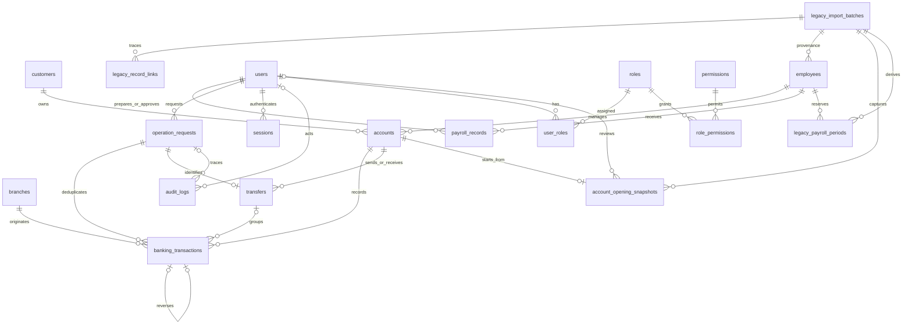

# Database design — Phase 2

The versioned baseline has been executed and tested on MySQL 8.0.43 in `banking_payroll_test`. The approved upgrade is also applied in `banking_payroll_db`, preserving all source objects/rows alongside the new tables. See `LEGACY_UPGRADE_EVIDENCE.json`.

## Core relational schema

| Table | Primary key | Important relationships / uniqueness |
| --- | --- | --- |
| customers | customer_id | Unique email; customer_status supports deactivation |
| employees | employee_id | Unique employee_code and email; department, designation and joining date |
| accounts | account_id | customer_id -> customers; employee_id -> employees; unique account_number |
| branches | branch_id | Unique branch_code; active/inactive status |
| payroll_records | payroll_id | employee_id -> employees; created_by/approved_by -> users; unique employee + payroll_period |
| banking_transactions | transaction_id | account_id -> accounts; branch_id -> branches; created_by -> users; request_id -> operation_requests; optional transfer/reversal references |

All identifiers are unsigned BIGINT except small lookup keys. All tables use InnoDB and utf8mb4. Money is DECIMAL(18,2); mysql2 returns money and large IDs as strings where appropriate. All connections set UTC session time and strict SQL mode. Dates such as joining/open dates are DATE, timestamps are DATETIME(6). Runtime email/phone validation and normalization arrive with the API.

## Supporting tables

| Table | Purpose and constraints |
| --- | --- |
| users | Login identities; invited/active/disabled; active identities require a password hash; scrypt authentication and opaque sessions are implemented |
| roles / permissions | Four initial role names and 27 explicit action grants |
| user_roles / role_permissions | Composite-key role assignments and permission mappings |
| operation_requests | Actor + operation + case-sensitive idempotency key is unique; payload hash and completion metadata |
| transfers | Source/destination account links, positive amount, request and reference uniqueness |
| sessions | Hashed session/CSRF tokens, user link, expiry and revocation constraints; no live login sessions yet |
| login_attempts | HMAC identity/address buckets and attempt time; authentication enforcement arrives later |
| audit_logs | Actor/request links and JSON before/after values; business mutations commit their audit events atomically |
| schema_migrations | SHA-256 migration content checksums and running/applied/failed markers |
| seed_runs | Seed checksum and timestamp for atomic, idempotent fictional initialization |

## ER diagram

The diagram abbreviates source/destination and creator/approver FKs as combined edges. Cardinalities do not imply a transfer has been fully posted: enforcing exactly two matching transfer entries and balance conservation belongs to Phase 3 procedures and Phase 6 API tests.

## Financial invariants in the baseline

- New accounts default to zero, are INR-only, cannot become negative, and cannot close with funds remaining.
- Completed transactions require positive amounts, valid related records, unique references, a per-request/account entry, and valid transfer/reversal linkage.
- Transfers require different accounts and positive amounts.
- `salary_amount` is the base salary for the payroll period. Gross = base + bonus; net = gross - deductions. Stored values must reconcile exactly; all inputs are nonnegative and deductions cannot exceed gross.
- Payroll periods use the first day of the month and are unique per employee. Approval requires a different actor from the preparer. Processed records require approval, dates and a unique processing reference. Rejection needs an explanation.
- Every modern historical FK uses RESTRICT; preserved legacy FKs may report equivalent NO ACTION; fixtures demonstrate that referenced customers, employees, branches and accounts cannot be deleted.

These are schema invariants, not a complete financial system. Stored routines, balance-changing permissions, immutability triggers, allowed state transitions, idempotent replay results, and concurrency semantics arrive in later phases. Database administrators can still edit records today; this baseline must not be exposed as a runtime banking API.

## Index strategy

Primary, unique and FK indexes are created by schema definitions/InnoDB. Migration 005 adds name search; department/status filtering; transaction date/account-date/branch-date order; payroll period/status; session expiry; login-attempt subject/time; and audit entity/time. The matching leftmost index may replace an implicit FK index. EXPLAIN tuning with representative datasets remains Phase 3/8 work, not a performance claim made by this phase.

## Migrations and seeds

The original six migrations define identity, core entities, financial history, supporting tables, indexes/ALTER TABLE, and reference roles/permissions. Statement markers separate SQL statements; multipleStatements remains disabled. Future procedure bodies can remain one statement between markers; do not add mysql-client DELIMITER directives.

The seed creates 5 disabled identities, 2 branches, 3 employees, 3 customers, 3 zero-balance accounts, and 1 draft payroll. No password is usable and no money movement is fabricated. One customer has no accounts; another has multiple accounts. A seed audit event labels the data fictional. Seeds and reference permissions are separate so a deployed schema does not acquire demo users automatically.

## Source references

MySQL checks are enforced from 8.0.16 onward; see [CHECK constraints](https://dev.mysql.com/doc/refman/8.0/en/create-table-check-constraints.html). InnoDB indexes FK columns and supports restricted deletes; see [foreign keys](https://dev.mysql.com/doc/refman/8.0/en/create-table-foreign-keys.html). DDL may implicitly commit; see [implicit commits](https://dev.mysql.com/doc/refman/8.0/en/implicit-commit.html). The migration runner therefore records incomplete DDL instead of promising a transaction rollback of an entire migration.
## Applied legacy convergence

Clean migration 007 renames modern payroll to `payroll_records`; 008 adds the shared provenance contract. The legacy track creates that target name directly, keeping the old `payroll` table and deduction trigger unchanged. Clean installations have 22 tables; the upgraded database has those modern tables (with separate migration metadata) plus six original tables, totaling 28.

| Additional table | Purpose |
| --- | --- |
| legacy_upgrade_migrations | Dedicated version/checksum/status tracking for additive legacy DDL |
| legacy_import_batches | Source schema/digest/counts, import time/identity and verification state |
| legacy_record_links | Unique source/target key mappings, original row digest and mapped/historical/unresolved state |
| account_opening_snapshots | Exact imported balance and review evidence, linked to account and batch |
| legacy_payroll_periods | Employee/month reservation derived from original pay_date, source payroll key and import batch |

Employees with missing historical designation/date_of_joining use NULL plus `legacy_incomplete` and a required batch FK. Other employee states still require both fields. Department width now preserves the source's 100-character capacity. Imported account numbers and branch/employee codes are deterministic LEGACY identifiers.

Four triggers protect the new tables: reject payroll INSERT/UPDATE overlapping a historical month, reject activation of an account with an unreviewed opening snapshot, and reject a posting against a nonactive account. These are narrow upgrade integrity rules; they do not implement balance updates or financial transaction atomicity. Future routines must enforce the full business contract.

Historical transaction/payroll sources are separate from modern postings. Reports must not replay or sum their amounts into the new opening-snapshot ledger. Two ambiguous transfers remain unresolved. Eleven candidate payroll months block accidental duplicate entry without claiming modern approval evidence. All ten imported balances remain frozen pending review.

Record links are a polymorphic provenance map (source/target table and ID), verified by the importer; they cannot carry a single target FK. Account snapshots, employee provenance and month reservations have direct FKs. New application grants must protect source history, import metadata and opening snapshots from arbitrary writes.
## Phase 4/5 schema extension

Migration 009 adds login_throttles (HMAC subject PK, window_start, attempt_count, window index and positive-count CHECK), row_version on customers/accounts/branches, and http_request_id on audit_logs. Both tracks converge on this extension: 23 clean tables, or 29 including legacy sources. No source table was altered.

API sessions/auth attempts use the earlier support tables. Throttles use atomic counter transactions. Record updates lock their row and reject stale versions; record mutation and audit snapshot commit together. Phase 3 financial atomicity, procedures and reporting remain separate unfinished work.

## Phases 3, 6 and 7 schema extension

Forward migrations 010–012 are identical on clean and legacy tracks. No baseline migration was rewritten. They add the financial routine layer, six INVOKER reporting views, immutable posted-history triggers, employee/payroll row versions, transfer-leg lookup indexing and payroll audit-history indexing. Table count stays at 23 clean / 29 upgraded; migration counts are 12 clean / 11 upgraded.

`v_account_reconciliation` compares account balance with the imported opening snapshot (zero for new accounts) plus deposits/transfer credits/reversal credits minus withdrawals/transfer debits/reversal debits. Historical legacy rows remain separate and are never counted twice. Report views default empty aggregates to zero and retain relevant empty parent records.

Payroll state flow: draft → pending_approval → approved → processed, or pending_approval → rejected → edited draft. The most recent editor becomes preparer; an independent authorized reviewer approves/rejects. Processing sets a unique reference and timestamps atomically. The processed row and its financial audit/request cannot be edited or deleted normally. Imported employee/month reservations also block duplicates before payroll becomes eligible.
