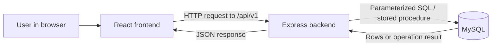

# Learn and demonstrate Ledgerline

## 1. Start here: three separate parts

The **frontend** is what the user sees: React pages, forms, tables and charts. **Vite** runs/builds that frontend. The **backend** is the Node.js/Express API: it checks login, permissions and input before performing operations. **MySQL** stores the records and enforces relationships, constraints and financial routines.



The browser never needs the MySQL password. Locally, frontend port 5173 forwards API requests to port 3001. In deployment, Vercel serves the frontend and API, and the API connects to hosted MySQL over verified TLS.

An **application user** logs into the website. A **MySQL user** connects software or Workbench to the database. A customer or employee record is not automatically a website login.

## 2. Create a user and assign roles

1. In PowerShell run `cd D:\DBMS`, then `npm run dev`. Keep that terminal running.
2. Open `http://127.0.0.1:5173/login`. Read the existing administrator credentials privately from `.env.admin.json` and sign in.
3. Open **Users**, or navigate directly to `/app/users`. Only an administrator can use this page.
4. Click **Create user**. Enter **Full name**, **Email address** and **Initial password** (12–128 characters).
5. Under **Assigned roles**, tick the required roles. The form starts with Auditor selected: untick it if the colleague should not receive auditor access.
6. Click **Review new user**, inspect the identity and role list, then **Confirm**.
7. Give the colleague their own login details privately. No invitation email is sent. Test their access by signing out and signing in as that user, or use a separate private browser window.

To change access later: open the person's name, adjust **Assigned roles** or **Account status**, click **Review changes**, then **Confirm**. Existing sessions are revoked. **Reset password** has its own review and confirmation. The app prevents you from removing your own administrator access or leaving no active administrator.

Roles are predefined: Administrator controls all modules; Banking Staff manages customers/accounts and banking operations; Payroll Manager manages employees and payroll; Auditor reads sensitive records/reports and exports, without business writes. Multiple roles combine permissions. See the full [role matrix](COLLEAGUE_GUIDE.md).

To demonstrate independent payroll approval, use two different authorized people: one prepares/submits and the other approves. Administrator status does not allow self-approval.

## 3. Inspect the backend database

Open installed **MySQL Workbench 8.0**. Connect with Standard TCP/IP, hostname `127.0.0.1`, port `3306`, username `root`, and your local MySQL password. Expand **Schemas → banking_payroll_db**. This password is separate from website login.

Open [LAB_DEMO_READ_ONLY.sql](LAB_DEMO_READ_ONLY.sql) in Workbench. Select one query and run it, inspecting one result at a time. The script covers tables/views, keys, user-role mappings, reconciliation, reporting views, routines, triggers, indexes and EXPLAIN. It contains no data-changing statements. User names/emails are still personal data; use fictional demonstration identities when projecting them.

For the full ER diagram use **Database → Reverse Engineer**, choose the connection/schema and place imported objects on a diagram. Save the `.mwb` model. See [connection instructions](CONNECT_AND_VISUALIZE.md).

Backend inspection also means tracing one request through code:

- `client/src/pages/UsersPage.tsx`: user form and review step.
- `client/src/services/api.ts`: HTTP requests/session behavior.
- `server/src/app.ts`: middleware and route wiring.
- `server/src/auth.ts`: session authentication, permissions and CSRF.
- `server/src/admin.ts`: user and role operations.
- `server/src/finance.ts`: financial endpoint validation and routine calls.
- `database/migrations`: versioned schema, procedures, views and triggers.

Run these read-only verification commands from the project directory:

```powershell
npm run db:verify
npm run db:upgrade:verify
npm run db:verify:financial
```

They respectively check schema/migrations/relationships, preservation of the original cutover data, and financial objects/balance reconciliation. They are not a substitute for testing every possible business scenario. The cutover verifier expects the initial imported state; legitimate later audited changes may change that expectation.

Current verified state: 29 main base tables, 35 foreign keys, 51 CHECK constraints, 22 UNIQUE constraints, nine routines and six modern reporting views. Five legacy views coexist with those modern views. All 61 original source rows are preserved. The test database has 23 base tables; the six extra main tables are the preserved original tables. Main accounts are frozen pending review, with no modern banking/payroll postings yet.

## 4. Explain the database concepts

| Concept | Explanation using this project |
| --- | --- |
| Primary key | A unique row identifier, such as customer_id |
| Foreign key | accounts.customer_id must reference an existing customer |
| One-to-many | One customer may own multiple accounts |
| Many-to-many | users and roles connect through user_roles |
| Normalization | Customers, accounts and roles are separate entities linked by keys, reducing duplicated facts; do not claim a formal normal-form proof without examining dependencies |
| UNIQUE | Prevents duplicate account numbers and duplicate employee/payroll periods |
| CHECK | Rejects invalid values such as negative balances |
| DECIMAL | Represents money exactly to two decimal places, avoiding binary floating-point rounding |
| Transaction | Transfer debit, credit, ledger entries and audit succeed together or roll back together |
| Row lock | Serializes conflicting account changes so concurrent withdrawals cannot overdraw |
| Idempotency | Repeating the same operation key after a timeout does not post money twice |
| Optimistic version | Rejects saving a stale edit after another user changed the record |
| Procedure | Server-side SQL operation such as sp_transfer_money |
| Function | calculate_net_salary returns a computed value |
| Trigger | Automatically blocks prohibited changes to posted history |
| View | A reusable SQL query, such as v_account_reconciliation |
| Index / EXPLAIN | An index can speed lookups; EXPLAIN shows the optimizer's chosen access plan |
| Audit log | Records who changed what and when; passwords are excluded |
| Migration | A versioned schema change with a stored checksum |

Reconciliation formula: **current balance = preserved opening balance + signed modern ledger movements**. Old history is retained separately to avoid counting it twice. Reversals add compensating entries rather than rewriting posted history.

Passwords are hashed, sessions use opaque tokens with server-side storage, SQL inputs are parameterized, and backend permissions are checked independently of hidden UI buttons. Database owners remain privileged; application controls do not make the system immune to an administrator with direct database access.

## 5. Deploy: what each step means

Deployment makes the app reachable from another computer. A Vercel build alone does not move the local database. You need a Git repository, a Vercel project, and a compatible hosted MySQL service.

1. **Prepare a private Git repository.** Review `.gitignore`, initialize the repository if needed, review staged files, and push the source to GitHub. Exclude `.env`, `.env.admin.json`, database backups and node_modules. Do not upload the complete folder through a file picker without reviewing its contents.
2. **Provision hosted MySQL.** It must support the project's MySQL 8 features: transactions, constraints, routines/functions, triggers, views and connection-scoped advisory locks. Record its hostname, port and TLS requirements privately. Provider selection and any cost require a separate decision.
3. **Prepare the cloud database.** Decide whether it should contain fictional lab data or a reviewed copy of existing records. Apply the appropriate migration track, set up durable routine definers and grant a restricted runtime account the required privileges. Provision an application administrator with a hashed password. Existing local setup scripts intentionally target localhost; do not assume changing `.env` to a cloud hostname completes this step. Migration, restore and grant commands must match the chosen provider.
4. **Import the repository into Vercel.** Use Add New → Project and select the Git repository. Root Directory is the repository root, not client. Use Vite, Node 24.x, install command `npm ci`, build command `npm run build`, output `client/dist`. The existing `vercel.json` routes both pages and API requests. See [Vercel Git deployment](https://vercel.com/docs/git) and [Vite deployment](https://vercel.com/docs/frameworks/frontend/vite).
5. **Configure server environment variables.** In project settings, add the values below for the intended deployment environment. Use separate preview/production databases. Variables belong in Vercel settings, not frontend source files.
6. **Deploy and check logs.** Confirm the project's stable HTTPS domain, set APP_ORIGIN to that exact origin with no trailing slash, then redeploy if it changed. Environment changes require a new deployment: [Vercel variable instructions](https://vercel.com/docs/environment-variables/managing-environment-variables).
7. **Test before sharing.** Open `/api/v1/health/ready` (must return ready), sign in, refresh `/app/reports`, test a restricted colleague account and sign out. A rendered landing page alone does not establish that MySQL is connected. Complete the [hosted acceptance checklist](VERCEL_DEPLOYMENT.md).

| Variable | What to enter |
| --- | --- |
| MYSQL_HOST / MYSQL_PORT | Hosted provider endpoint, not 127.0.0.1 |
| MYSQL_DATABASE | Prepared cloud schema name |
| MYSQL_RUNTIME_USER / MYSQL_RUNTIME_PASSWORD | Restricted cloud API account |
| MYSQL_SSL | true |
| MYSQL_SSL_CA | Only if required: deployed CA file path, not a Windows path |
| AUTH_SECRET | Newly generated random server secret, at least 43 characters |
| APP_ORIGIN | Exact deployed HTTPS origin |
| NODE_ENV | production |

Never use a `VITE_` prefix for credentials. Do not put MySQL root or bootstrap credentials into the deployed API. Generate a secret locally with `node -e "console.log(require('node:crypto').randomBytes(32).toString('base64url'))"` and keep its output private.

No deployment has been performed yet. You can demonstrate locally for the lab before cloud setup is complete. Sharing the app from your PC through a public database port is not required.

## 6. A five-minute lab explanation

**Opening:** “Ledgerline is a banking and payroll management application. It uses React for the interface, Express for authenticated business APIs and MySQL for relational storage. It records academic financial operations, not real bank payments.”

**Architecture:** Show the request-flow diagram. Explain that the backend validates each request and uses a restricted database account.

**Database:** Show customers/accounts/employees relationships, user-role join tables, a CHECK constraint, one reporting view, a stored procedure and an immutable-history trigger.

**Workflow:** In a separate fictional demonstration database, show a reviewed transfer and its reference. Explain all-or-nothing posting and retry keys. Show payroll preparation and independent approval using separate users.

**Roles:** Sign in as an auditor to show read/export access without mutation controls. Explain that the API also rejects unauthorized requests.

**Opening-balance review:** “Imported accounts start frozen. An administrator compares the source and opening balances, verifies that opening balance plus ledger movements equals current balance, and records a review note. The application verifies the original source fingerprint and writes the review and audit event atomically. Review never changes money; activating the account is a separate action.”

**Verification and limits:** “114 automated tests passed at the 15 October checkpoint, with schema, API and component coverage. Original data was preserved and balances reconcile. The application has been deployed by the owner; the latest fixes still need the documented cloud permission update and deployment. Manual responsive acceptance and hosted acceptance of those fixes remain outstanding.”

Be ready to answer: Why DECIMAL? Why foreign keys? What happens if a transfer fails halfway? What if two withdrawals happen together? Why cannot payroll be self-approved? Why does the database have both singular legacy tables and modern plural tables? The answers above describe the implemented behavior.
